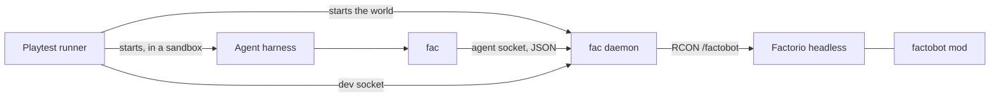

# factobot

factobot is a benchmark harness built on [Factorio](https://www.factorio.com/). An agent plays a real headless game through the `fac` command line, with the same limits a player has: it walks, mines, crafts, and builds in game time, inside reach, and it only sees the map it has explored. The game keeps running while the model thinks. A score is the game time until a milestone the harness reads from the game.

The game is Factorio 2.1, base game only, peaceful, with no enemy bases. The version and its checksum are pinned in `mise.toml`. factobot downloads the headless server at setup and does not redistribute the game. Text-only runs need no Factorio account.

[Quickstart](docs/quickstart.md): install the tools and compile `fac` once, then run the smoke benchmark. That run finishes in under 5 minutes. The download and the first compile take longer.

```bash
mise run playtest -- playtests/smoke.md --timeout 180 -- \
  /usr/bin/python3 -c 'import json,subprocess; s=json.loads(subprocess.check_output(["fac","status"])); g=s["result"]["game"]; print(json.dumps({"tick":g["tick"],"version":g["game_version"]}))' \
  {prompt}
```

## Architecture

A playtest runner boots one headless server and one agent. The agent is in a bubblewrap sandbox. Inside it, `fac` is the agent build (`fac-agent`), which has no `daemon`, `dev`, or `watch` commands. The runner keeps the dev socket and reads milestones on it. Commands reach the server only from the daemon, through the mod's `/factobot` console command, which returns one JSON line.



`fac` and the Python client speak the same socket protocol, version 3: one JSON object per line. The spec is [`docs/protocol.md`](docs/protocol.md).

Every agent command prints one JSON object on stdout and exits non-zero when the game refuses it or the job it prints has ended `failed`. An action that reaches the game also carries `hud`: the game clock, free inventory slots, the research bar, and warnings when research is idle, power is short, or a machine in view shows a warning icon. `fac status` does not carry `hud`. A status result has this shape (the numbers are an example):

```json
{
  "v": 3,
  "id": 1,
  "ok": true,
  "result": {
    "daemon": {"version": "0.1.0", "protocol": 3},
    "game": {
      "tick": 227,
      "tick_paused": false,
      "speed": 1,
      "game_version": "2.1.24",
      "mod_version": "0.5.0",
      "connected_players": 0
    }
  }
}
```

`walk`, `mine`, `craft`, and `place --to` start a job and return at once. `--wait` blocks until the job ends, up to 600 seconds, while the game keeps running. `place`, `insert`, `take`, `rotate`, `recipe`, `research`, and `launch` happen at once.

| Command | What it does |
|---|---|
| `fac status` | Tick, game version, mod version |
| `fac observe` | What is around the body. `--problems` lists machines that are not working |
| `fac inventory` | What the body carries |
| `fac map` | Ore, stone, coal, crude oil, and water on the explored map |
| `fac stats` | Production window: made and used per minute, and in total |
| `fac walk`, `fac mine`, `fac craft` | Jobs. Pass `--wait` to block until they finish |
| `fac place` | Put down a building. `--to` drags a line, which is a job |
| `fac insert`, `fac take`, `fac rotate` | Use a building in reach |
| `fac recipe` | Set an assembler, chemical plant, or refinery recipe |
| `fac research` | Read the tech tree, or queue a technology |
| `fac inspect` | One entity within 32 tiles |
| `fac launch` | Launch a rocket from a silo in reach |
| `fac screenshot` | What the body sees. Needs a world started with a camera |

`fac --help` and `fac <command> --help` are the agent's manual. Each command's help has examples.

## Results

A run writes a directory under `target/playtests/<task>-<time>-<random>/`. The runner also prints the same summary on stdout.

| File | What it is |
|---|---|
| `summary.json` | The result: agent, seed, ticks, milestone, pack counts, and how the process ended |
| `transcript.jsonl` | The harness's stdout |
| `world/calls.jsonl` | Every daemon call: method, params, response, and the game tick |
| `world/save.zip` | The world, written when the server quits |
| `world/server.log`, `world/daemon.log` | The game log and the daemon log |

On a scored run (`--until automation-science-pack` or `--until rocket`), `milestone_tick` is the tick the harness saw the goal, and the process exits 0 only when that field is set. The stage time in ticks is `milestone_tick - start_tick`. `mise run report` scores every run under `target/playtests` and writes a markdown and HTML leaderboard (`docs/development.md`, Leaderboard).

Red science, the first ladder stage, is a fresh map until labs research with an automation science pack made by a machine. Hand-crafted packs do not count. The reference time is 5 hours, which is 1,080,000 ticks at 60 ticks a second. The score is that reference divided by the stage time, when the milestone falls inside twice the reference (10 hours, 2,160,000 ticks). A run that misses the milestone scores 0.25. Later ladder stages need fixed starting saves, which this repo does not include yet. A run that passes `--skill` is assisted. The rocket task is one of those. Report its time apart from benchmark scores.

`packs` lists science packs the force has made by hand, made by machine, or used in labs. `research` lists technologies that finished during the run, with the tick of the poll that first saw each one (about every 5 seconds, so up to one poll late). Field-by-field notes are in the [quickstart](docs/quickstart.md#results).

## Further reading

- [Quickstart](docs/quickstart.md): setup, the smoke run, a model harness, and red science.
- [`docs/protocol.md`](docs/protocol.md): the socket protocol.
- [`docs/decisions.md`](docs/decisions.md): design record, including how a stage is scored.
- [`docs/development.md`](docs/development.md): contributor setup, tests, and the live game.

The Inspect AI tasks (`inspect eval factobot/red_science`) are shelved, not removed (decision 46): their code and tests stay, and the [quickstart](docs/quickstart.md#red-science) has the command. The MCP server and the synthetic top-down render in `docs/decisions.md` (decisions 4, 7 and 11) are not built yet.

## License

Licensed under either of [Apache License 2.0](LICENSE-APACHE) or [MIT](LICENSE-MIT), at your option.

Factorio is a trademark of Wube Software. factobot downloads the game at runtime and never redistributes it.
